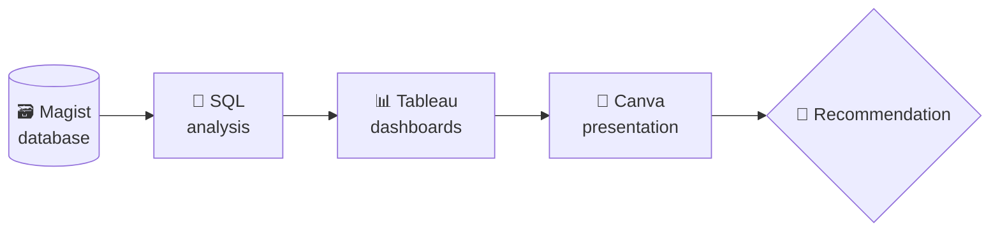

<div align="center">

# 🛒 Eniac × Magist
### Brazilian E-Commerce Analysis

**Should Eniac sign a three-year partnership with Magist?**

*A data-driven partnership assessment: SQL → Tableau → Recommendation*

<br>


[][canva]


<br>

<br>

[About](#-about-the-project) •
[Question](#-business-question) •
[Numbers](#-key-numbers) •
[Method](#-methodology) •
[Findings](#-key-findings) •
[Recommendation](#-recommendation) •
[Files](#-repository-structure) •
[Team](#-team)

</div>

---

## 📌 About the Project

This project is a **fictional business case** about **Eniac**, a European technology company that wants to expand into the Brazilian market.

Eniac is evaluating a **three-year partnership with Magist**, a Brazilian e-commerce service provider. Our task: analyze Magist's e-commerce data and decide whether Magist is a suitable partner, with a clear focus on **selling and distributing technology products** in Brazil.

> [!NOTE]
> This is a learning project built during the Data Science program at **WBS Coding School**. The dataset is fictional.

---

## 🎯 Business Question

> ### Should Eniac sign a three-year partnership with Magist?

We answer it from four business perspectives:

| # | Perspective | Key questions |
|:-:|-------------|---------------|
| 1️⃣ | **📦 Product Portfolio** | Which categories generate the most revenue? Which tech categories perform best? |
| 2️⃣ | **🚚 Sellers & Delivery** | How long do sellers take to deliver? Which sellers have enough volume to be reliable? |
| 3️⃣ | **🌎 Geographic Reach** | Which states and cities generate the most orders and revenue? |
| 4️⃣ | **⭐ Reliability & Satisfaction** | How many orders arrive on time? Do late deliveries hurt customer reviews? |

---

## 📈 Key Numbers

<div align="center">

| | **ENIAC** | **MAGIST** |
|:--|:-:|:-:|
| 💶 **Annual revenue** | **14 M €** | **6.9 M €** |
| 🏷️ **Average product price** | **540 €** | **124 €** |
| 🛍️ **Price range of tech products** | – | **57 € – 1,100 €** |

| 🚚 Magist delivery time | 🇧🇷 Brazil average | ⏱️ Gap | 🇪🇺 EU standard |
|:-:|:-:|:-:|:-:|
| **12.5 days** | **8 days** | **+4.5 days** | **3 – 7 days** |

</div>

> [!IMPORTANT]
> Magist sells everything from small parts to expensive PCs. That is why its **average price (124 €)** is far below Eniac's **(540 €)**, even though the range reaches 1,100 €.

---

## 🧭 Methodology



<details open>
<summary><b>📦 Product performance</b></summary>
<br>

We identify the categories with the highest revenue and evaluate how technology-related products perform.

</details>

<details open>
<summary><b>🚚 Seller & delivery performance</b></summary>
<br>

We analyze seller delivery times and compare sellers with a significant number of tech-related orders.

> 💡 **Threshold:** only sellers with **at least 100 relevant orders** are compared, to ensure a meaningful basis.

</details>

<details open>
<summary><b>🌎 Geographic performance</b></summary>
<br>

We analyze orders and revenue by Brazilian **state** and **city** to identify Magist's strongest markets.

</details>

<details open>
<summary><b>⭐ Customer satisfaction</b></summary>
<br>

We compare reviews for orders **delivered on time** versus **delivered late** to see whether delivery performance affects satisfaction.

</details>

---

## 🔎 Key Findings

### 🗺 Where does Magist earn its money?

The strongest revenue comes from the **southeast and the east coast** of Brazil, led by **São Paulo** and **Rio de Janeiro**.

| 🏆 | City | 🏆 | City |
|:-:|------|:-:|------|
| 1 | São Paulo (SP) | 6 | Porto Alegre (RS) |
| 2 | Rio de Janeiro (RJ) | 7 | Campinas (SP) |
| 3 | Belo Horizonte (MG) | 8 | Salvador (BA) |
| 4 | Brasília (DF) | 9 | Guarulhos (SP) |
| 5 | Curitiba (PR) | 10 | Niterói (RJ) |

*Top 10 cities by revenue.*

### 🚚 Delivery is the biggest operational risk

```text
Magist        ████████████████████████  12.5 days
Brazil (avg)  ███████████████            8 days
EU standard   ██████ – ██████████████    3 – 7 days
```

- Magist delivers on average **4.5 days slower** than the Brazilian average, even though Brazilian logistics is considered dynamic and advanced overall.
- Late deliveries on top of a long delivery time make this the **most important risk point** of the analysis.

> [!WARNING]
> The Brazilian average of 8 days refers to the Black Friday 2025 period, a peak-load phase. Compare with care.

---

🏁 Recommendation
The final recommendation on the three-year partnership is based on the combined findings across portfolio, sellers, geography and delivery.

👉 Open the final presentation on Canva

---

## 🧰 Tech Stack

| Tool | Purpose |
|------|---------|
|  | Data analysis and business questions |
|  | Data visualization |
|  | Final presentation |
|  | Documentation and version control |

### 💾 Data

The project uses a **fictional dataset** based on Magist's e-commerce database:

| | | | |
|:-:|:-:|:-:|:-:|
| 🛍️ Products | 🏷️ Categories | 🧑‍💼 Sellers | 👥 Customers |
| 🧾 Orders | 📋 Order items | 💳 Payments | ⭐ Reviews |
| 🌎 Geographical data | | | |

---

## 📁 Repository Structure

```text
📦 eniac-magist
 ┣ 📄 README.md             → Project overview, questions, findings
 ┣ 📄 script.sql            → SQL queries used for the analysis
 ┣ 📊 visualizations.twbx   → Tableau visualizations
 ┗ 📑 presentation.pdf      → Final presentation (PDF export)
```

| File | Description |
|------|-------------|
| [`README.md`](README.md) | Project overview, business questions, findings |
| [`script.sql`](script.sql) | SQL queries for the data analysis |
| [`visualizations.twbx`](visualizations.twbx) | Tableau workbook |
| [`presentation.pdf`](presentation.pdf) | Final presentation and recommendation |

---

## 👥 Team

<div align="center">

| 👩‍💻 Elham Khezri | 👨‍💻 Miguel Arcangel Gamardo Linares | 👨‍💻 [Taris Beck](https://github.com/Mk1Becks) |
|:-:|:-:|:-:|

<br>

⭐ *If you like this project, leave a star!*

</div>

---

[canva]: https://www.canva.com/design/DEIN-LINK
